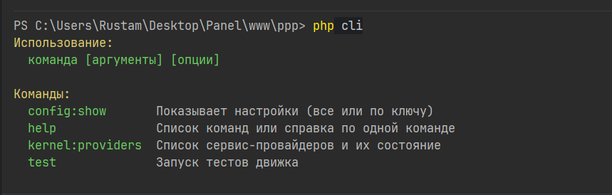
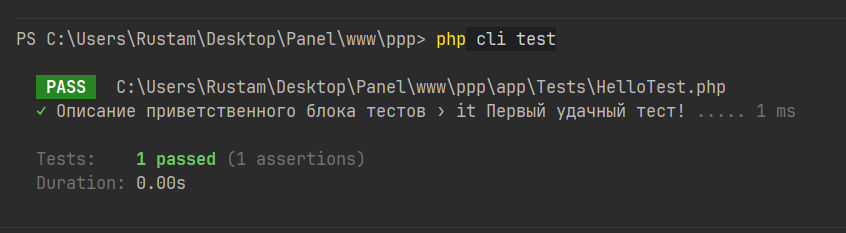

# Neo PHP Framework

Ядро приложения для PHP. PHP 8.5+

# Расширения

## 🏗️🧱Foundation
- Автозагрузчик классов и файлов.
- Автоматическая проверка версии PHP и пакетов.
- Конфигурации в массиве и хелпер `config()`/`env()`.
- ServiceProvider, ServiceContainer, Facade.
- Консоль приложения и отдельные команды `php cli`.

## 🩺🩸Diagnostic
- Встроенный тестировщик `php cli test`.
- Встроенный дампер `dd()`/`dump()`.
- Профилировщик с замерами `profiler()`.

## 💾📂Information
- Файловые языки через функцию `__()`.
- Файловое хранилище через фасад `Storage::`.
- Реляционное хранилище, миграции, фабрики, сидеры.
- Транспортировщик данных `Transfer`.
- Валидация данных через фасад `Validator::`.

## Консоль

## Тестирование

## Профайлер
