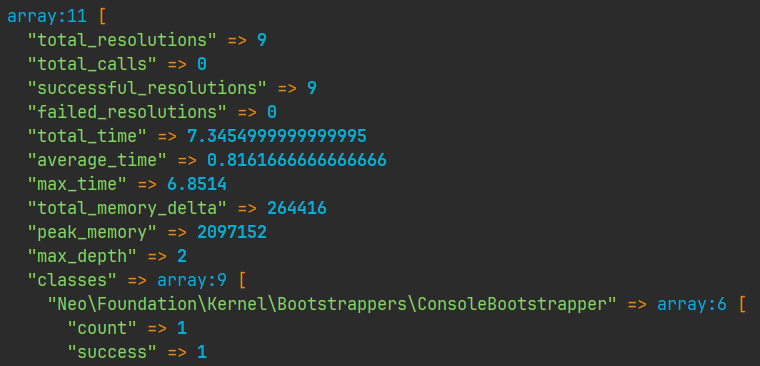

# Neo PHP Framework

Ядро приложения для PHP. Использует PHP 8.5+. 

# Расширения

## 🏗️🧱Foundation
- Автозагрузчик классов и файлов.
- Автоматическая проверка версии PHP и пакетов.
- Конфигурации в массиве и хелпер `config()`/`env()`.
- ServiceProvider, ServiceContainer, Facade.
- Observer, EventListener, EventDispatcher.

## 🩺🩸Diagnostic
- Встроенный тестировщик `php cli test`.
- Встроенный дампер `dd()`/`dump()`.
- Профилировщик с замерами `profiler()`.

## 💾📂Information
- Файловое хранилище через фасад `Storage::`.
- Реляционное хранилище, миграции, фабрики, сидеры.
- Транспортировщик данных `Transfer`.
- Специальный фасад для даты и времени `Chronos::`.
- Логирование данных фасадом `Log::`
- Универсальное сессионное хранилище: `Session::`
- Лёгкий доступ к браузерным кукам: `Cookie::`
- Обёртка над массивами фасадом `Collection::`

## 🗺️🌐Network
- Маршрутизатор HTTP-запросов `Route::`
- Middleware, Request, Response, Controller.
- UDP-клиент: Datagram Request-Response-Header.
- HTTP-клиент для запросов на сторонние сервисы.
- UDP-сервер: можно делать STUN/TURN и другое.
- Автоматическая генерация API: `ResourceAPI`.
- Автоматическая API-документация: `/docs/api`.
- Сортировка, фильтрация, пагинация `ResourceAPI`.

## 🔒🔑Security
- Идентификация, аутентификация, авторизация.
- Roles, Permissions, Guard, Policy, Gate.
- CSRF-защита пользовательских форм.
- XSS-защита, фасад `Crypt::`, CORS.

## 🌆🌇Presentation
- Консоль приложения и отдельные команды `php cli`.
- Универсальный шаблонизатор HTML `View::`.
- Файловые языки через функцию `__()`.
- Генерация писем и шаблонов фасадом `Mail::`
- Валидация данных через фасад `Validator::`.

## 🛡️🛠️Administration
- Отдельная роль для администраторов.
- Dashboard, Widget, DataTable.
- Create, Read, Update, Delete, List.

# Готовые системы

## 📢📝CMS
- Extends Administration functionality.
- Pages, Taxonomies, Tags, Categories.
- Menu, Comments, Posts, Templates.
- Система полнотекствоого поиска.
- Аналитика пользователей и ссылок.
- SEO, meta-поля, URL-Permalinks.

## 🛒🏷️eCommerce
- Extends CMS functionality.
- Products, Orders, Checkout, Stock.
- Variants, Payments, Shipping, Cart.
- Promotions, Coupons, Banners.

## Консоль

## Тестирование

## Профайлер
