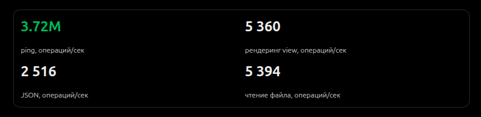

# Neo PHP Framework

Ядро синхронного приложения для PHP с возможностью асинхронности. 
Использует PHP 8.5+. Задумка в том, чтобы мочь делать маленькие 
приложения без боли, с опцией того, что они могут стать монстрами. 
Акцент и упор сделан на быстрый старт и быстрый рост без боли.

# Установка 

Для подробностей установки зайдите в файл `INSTALL.MD`.

# Скорость

| Concurrency	 | Neo RPS	   | Laravel RPS | Преимущество Neo |
|---------------|-------------|-------------|------------------|
| 10	         | 🏆 `4 641`  | 	2 050	   | **2,26×**        |     
| 25	         | 🏆 `6 874`  | 	2 263	   | **3,04×**        |       
| 50	         | 🏆 `6 862`  | 	2 264	   | **3,03×**        |      
| 100	         | 🏆 `6 858`  | 	2 200	   | **3,12×**        |     
| 200	         | 🏆 `6 682`  | 	1 999	   | **3,34×**        |    
| 400	         | 🏆 `6 658`  | 	2 174	   | **3,06×**        |

# Расширения

## Первый эшелон.

## ⚙️⛓️‍Runtime
- Базовый рантайм синхронного PHP по умолчанию.
- Swoole Runtime: 'php cli serve --swoole'.
- Возможность делать другие async рантаймы. 
- Coroutines, Background, Streaming, Threads.
- State Reset, Context, Async IO, DB Pool.

## 🏗️🧱Foundation
- Автозагрузчик классов и файлов.
- Автоматическая проверка версии PHP и пакетов.
- Конфигурации в массиве и хелпер `config()`/`env()`.
- ServiceProvider, ServiceContainer, Facade.
- Observer, EventListener, EventDispatcher.

## 🩺🩸Diagnostic
- Встроенный тестировщик `php cli test`.
- Встроенный дампер `dd()`/`dump()`.
- Профилировщик с замерами `profiler()`.
- Логирование данных фасадом `Log::`
- Универсальный web-Exception Handler.

## Второй эшелон.

## 💾📂Information
- Файловое хранилище через фасад `Storage::`.
- Реляционное хранилище, миграции, фабрики, сидеры.
- DTO, DataMapper, Validator в одном лице: `Transfer`.
- Универсальное сессионное хранилище: `Session::`.
- Лёгкий доступ к браузерным кукам: `Cookie::`.
- Специальный фасад для даты и времени `Chronos::`.
- Обёртка над массивами фасадом `Collection::`.
- Универсальный Markdown парсер `Markdown::`.

## 🗺️🌐Network
- Маршрутизатор HTTP-запросов `Route::`.
- Middleware, Request, Response, Controller.
- HTTP-клиент для запросов на сторонние сервисы.
- UDP-клиент: Datagram Request-Response-Header.
- UDP-сервер: можно делать STUN/TURN и другое.
- Автоматическая генерация API: `ResourceAPI`.
- Автоматическая API-документация: `/docs/api`.
- Сортировка, фильтрация, пагинация `ResourceAPI`.

## 🔒🔑Security
- Идентификация, аутентификация, авторизация.
- Roles, Permissions, Guard, Policy, Gate.
- CSRF-защита пользовательских форм.
- XSS-защита, фасад `Crypt::`, CORS.
- Встроенные валидаторы `Validate::`, `Rule::`.

## Вспомогательный эшелон.

## 🌆🌇Presentation
- Консоль приложения и отдельные команды `php cli`.
- Универсальный шаблонизатор HTML `View::`.
- Файловые языки через функцию `__()`.
- Генерация писем через встроенный шаблонизатор.

## 📬📭Messaging
- Jobs, Queue, Notifications, Publish-Subscriber.
- Отправка писем на почту через фасад `Mail::`
- Репортинг логов в разные каналы: file, Telegram.
- Scheduler, Broadcasting

# Готовые системы 

Следующие системы являются не обязательными и включаются отдельно, 
чтобы не нагружать основной контейнер зависимостями. 

## 🛡️🛠️Administration
- Отдельная роль для администраторов.
- Dashboard, Widget, DataTable.
- Create, Read, Update, Delete, List.

## 📢📝CMS
- Наследует Administration функионал.
- Pages, Taxonomies, Tags, Categories.
- Menu, Comments, Posts, Templates.
- Система полнотекстового поиска.
- Аналитика пользователей и ссылок.
- SEO, meta-поля, URL-Permalinks.

## 🛒🏷️eCommerce
- Ннаследует CMS функционал.
- Products, Orders, Checkout, Stock.
- Variants, Payments, Shipping, Cart.
- Promotions, Coupons, Banners.

## Консоль

## Тестирование

## Профайлер

## Performance 
